# Student Record Search System (BST)

DSA Mini Project (PPF Week 9) - Student Record Search System Using Trees

## Features
- Insert student records (duplicate enrolment IDs rejected)
- Search by enrolment ID
- Delete (leaf, one child, two children)
- Inorder, preorder and postorder traversals
- Load 10 sample records
- Comparison of balanced vs sorted insertion

## How to Compile and Run
Dev-C++: open bst.c and press F11
Command line:
gcc bst.c -o bst
./bst

## Complexity
- Insert / Search / Delete: O(log n) average, O(n) worst
- Traversal: O(n)
- Space: O(n)

## Screenshots
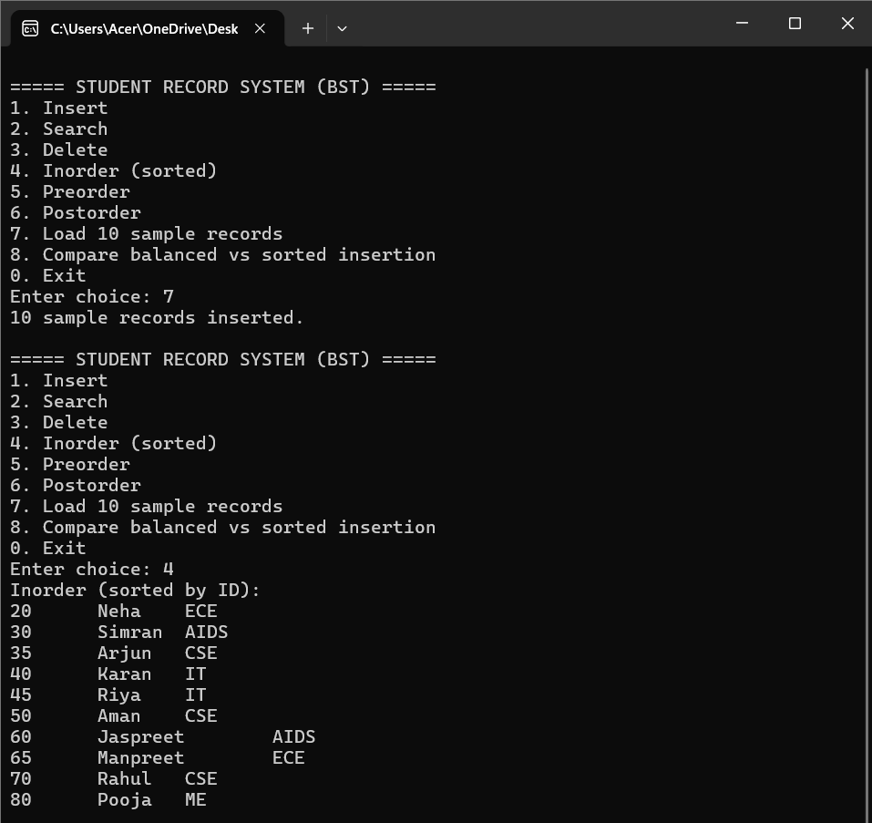
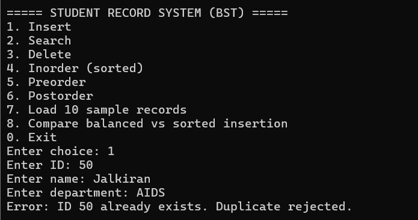
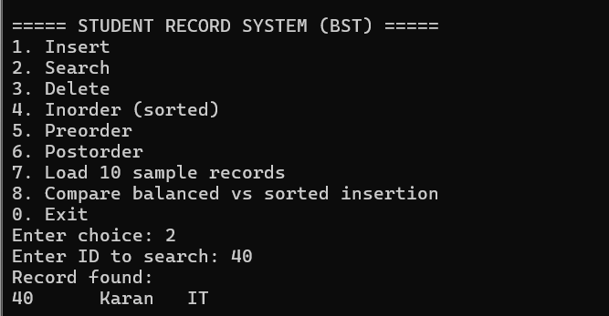
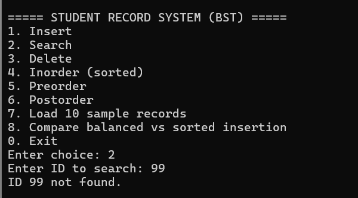
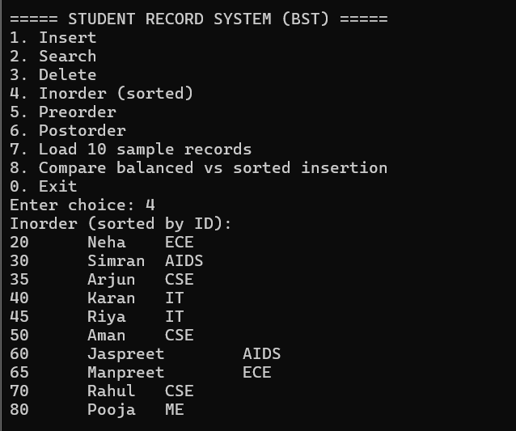
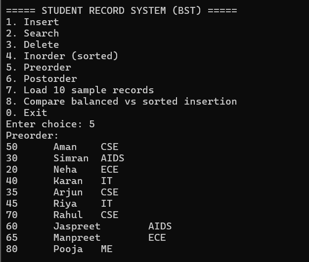
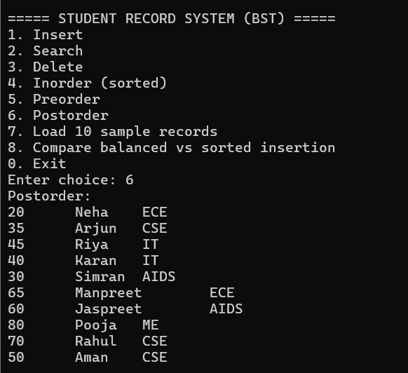
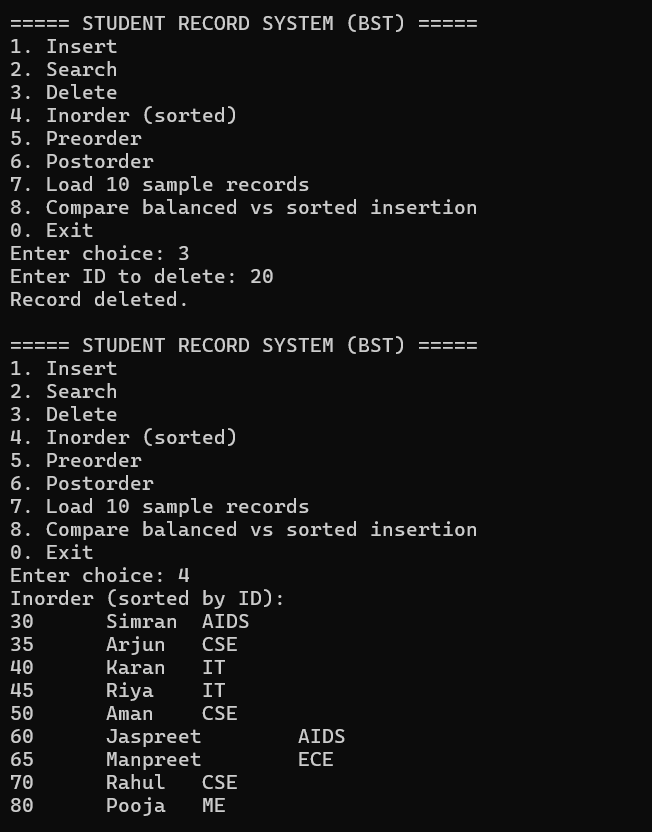
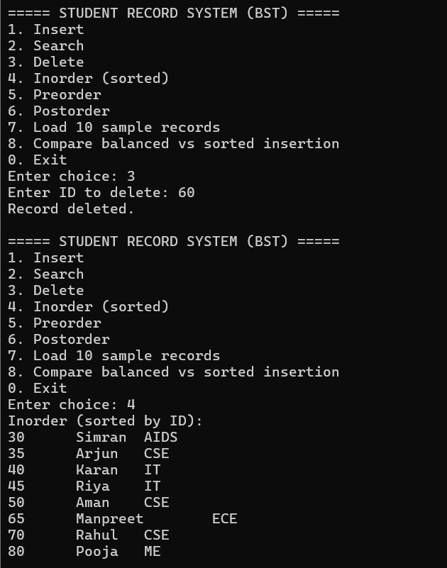
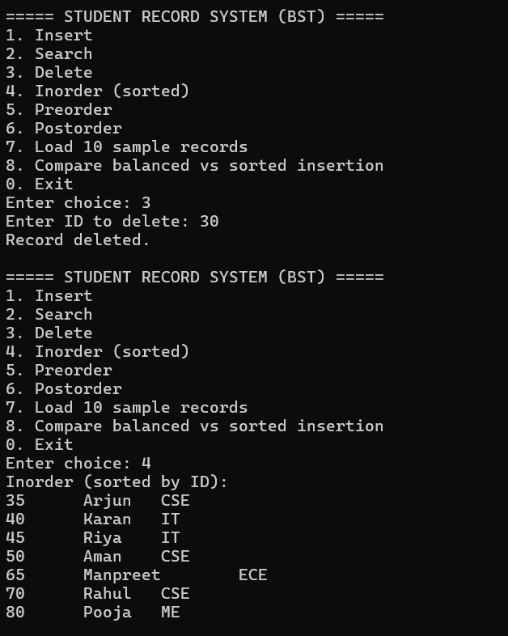
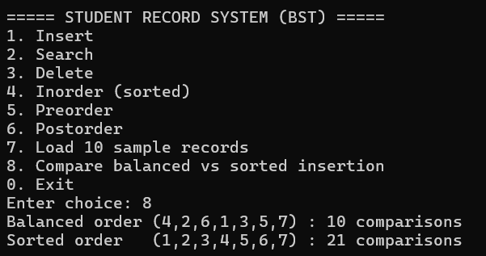

## Report
See report/Project_Report.pdf

## Author
Jalkiran Kaur | Roll No.: 2556582 | B.Tech (AI&DS)